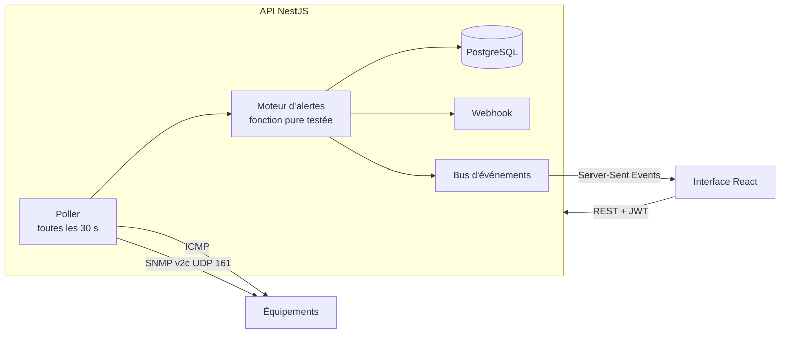

# NetWatch — Supervision réseau

[](https://github.com/ebarrault/NetWatch/actions/workflows/ci.yml)

Outil de supervision qui fait le pont entre réseau et développement : une API **NestJS** interroge régulièrement les équipements (**ping ICMP** et **SNMP v2c**), calcule leur état, ouvre et clôture des **alertes**, et une interface **React** affiche le tout **en temps réel**.

**Stack** : NestJS 10 · Prisma · PostgreSQL · net-snmp · Server-Sent Events · React 18 + Recharts · Docker Compose · GitHub Actions

## Fonctionnalités

- **Contrôles périodiques** (30 s par défaut) : ping avec mesure de latence, SNMP `sysName`, `sysDescr`, `sysUpTime`, table des interfaces (`ifDescr`, `ifAdminStatus`, `ifOperStatus`)
- **États** : *disponible*, *dégradé*, *hors ligne*, *inconnu*
- **Alertes** : équipement injoignable, latence au-dessus du seuil, agent SNMP muet, interface tombée, redémarrage détecté — ouverture et **clôture automatiques**, prise en charge par un technicien
- **Anti-faux positifs** : un équipement n'est déclaré hors ligne qu'après N échecs consécutifs (2 par défaut)
- **Temps réel** : les changements d'état et les alertes arrivent dans le navigateur sans rechargement (SSE)
- **Historique** : courbe de latence sur 1 h / 24 h / 7 j, taux de disponibilité, historique des alertes, purge automatique
- **Notifications** : webhook Discord, Slack ou Teams
- **Sécurité** : JWT, communauté SNMP jamais renvoyée au navigateur, validation des noms d'hôte et `execFile` (pas d'injection de commande via le ping)

## Architecture



Le cœur de la logique (`backend/src/monitoring/engine.ts`) est une **fonction pure** : elle reçoit l'état précédent, le résultat du contrôle et les alertes ouvertes, et renvoie le nouvel état, les alertes à ouvrir et celles à clôturer. Elle est donc entièrement couverte par des tests unitaires, sans réseau ni base de données.

## Démarrer le labo

```bash
docker compose up --build
```

| Service | URL |
|---|---|
| Interface | http://localhost:8082 — `admin@supervision.local / Admin123!` |
| Swagger | http://localhost:3002/api/docs |

Le labo démarre aussi **cinq équipements simulés** (conteneurs avec un agent Net-SNMP) qui portent les noms du [projet réseau](https://github.com/ebarrault/Lab-Cisco-PME), plus une borne Wi-Fi volontairement injoignable pour voir une alerte dès le départ.

### Scénarios de démonstration

```bash
./lab/scenarios.sh panne     # coupe R-AGENCE  → alerte critique
./lab/scenarios.sh retour    # le rallume       → alerte résolue + redémarrage détecté
./lab/scenarios.sh latence   # +150 ms sur SRV-WEB → état dégradé
./lab/scenarios.sh normal
./lab/scenarios.sh reboot    # redémarre SW-CORE-SIEGE → alerte info
```

### Sur le vrai labo Cisco

Voir [docs/brancher-le-labo-cisco.md](docs/brancher-le-labo-cisco.md) : topologie du projet 3 dans GNS3, configuration SNMP en lecture seule restreinte par ACL, déclaration des équipements.

## Configuration

| Variable | Défaut | Rôle |
|---|---|---|
| `POLL_INTERVAL_SECONDS` | 30 | fréquence des contrôles |
| `FAILURES_BEFORE_DOWN` | 2 | échecs consécutifs avant « hors ligne » |
| `RETENTION_DAYS` | 7 | conservation des mesures |
| `ALERT_WEBHOOK_URL` | — | webhook Discord / Slack / Teams |

## Tests et CI

```bash
cd backend && npm test
```

- **Unitaires** : moteur d'alertes (anti-flapping, ouverture/clôture, interfaces, redémarrage, latence), analyse de la sortie `ping` Linux/Windows FR/EN, protection contre l'injection, décodage SNMP.
- **Intégration** (GitHub Actions) : la CI démarre toute la pile Docker avec les équipements simulés, vérifie qu'ils sont vus *disponibles* avec leur `sysName` SNMP, coupe un équipement et vérifie l'ouverture de l'alerte.

## API

| Méthode | Route | Description |
|---|---|---|
| GET | `/api/devices` | équipements + état + nombre d'alertes ouvertes |
| POST / PATCH / DELETE | `/api/devices[/:id]` | gestion |
| GET | `/api/devices/:id/history?hours=24` | mesures, disponibilité, latence moyenne |
| POST | `/api/devices/:id/check` | contrôle immédiat |
| GET | `/api/alerts?status=open\|resolved\|all` | alertes |
| POST | `/api/alerts/:id/ack` | prise en charge |
| GET | `/api/events?token=…` | flux temps réel (SSE) |
